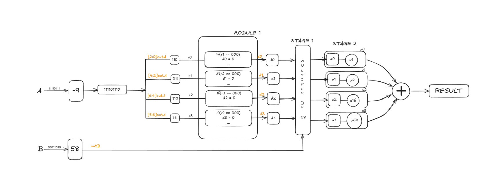
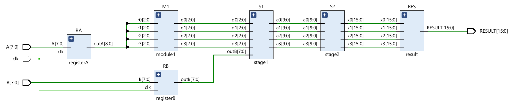
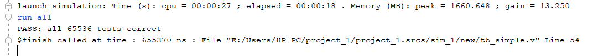
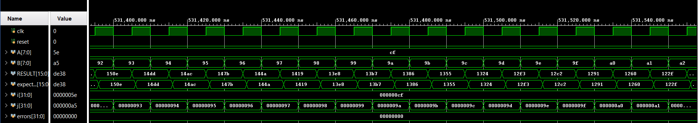

# Booth Radix-4 Multiplier (Verilog)

An **8-bit signed multiplier** built with **radix-4 Booth encoding** in Verilog. It uses a parallel architecture (4 partial products added in a single stage) and is verified **exhaustively**: a self-checking testbench runs **all 65,536 input combinations** and finds **0 errors**.

| | |
|---|---|
| **Inputs** | `A[7:0]`, `B[7:0]` (signed, two's complement), `clk` |
| **Output** | `RESULT[15:0]` (signed product) |
| **Partial products** | 4 (instead of 8 for a simple shift-and-add multiplier) |
| **Verification** | All 65,536 input pairs, self-checking, 0 errors |
| **Tools** | AMD Vivado 2025.2, Vivado Simulator |
| **Target part** | Artix-7 `xc7a35tcpg236-1` |

---

## Table of contents

1. [Why Booth radix-4?](#1-why-booth-radix-4)
2. [Architecture](#2-architecture)
3. [Module-by-module description](#3-module-by-module-description)
4. [Worked example: -9 x 58](#4-worked-example--9-x-58)
5. [RTL schematic](#5-rtl-schematic)
6. [Verification](#6-verification)
7. [Repository structure](#7-repository-structure)
8. [How to run](#8-how-to-run)
9. [Possible future work](#9-possible-future-work)
10. [Author](#10-author)

---

## 1. Why Booth radix-4?

A simple multiplier creates **one partial product for every bit** of A, so an 8-bit A gives **8 rows** to add. More rows means a bigger and slower adder.

**Radix-4 Booth encoding** reads A **two bits at a time** (plus one overlapping bit from the previous pair). Each group of 3 bits is converted into one digit from the set **{ -2, -1, 0, +1, +2 }**. Multiplying B by any of these digits is easy in hardware:

- `0` -> nothing
- `+1` -> B
- `+2` -> B shifted left by 1
- `-1` -> negative of B
- `-2` -> negative of B shifted left by 1

So an 8-bit A needs only **4 rows**, which **halves the number of partial products**.

### Booth radix-4 recoding table

| 3-bit group (b[2i+1], b[2i], b[2i-1]) | Digit | Partial product |
|:---:|:---:|:---:|
| 000 | 0 | 0 |
| 001 | +1 | +B |
| 010 | +1 | +B |
| 011 | +2 | +2B |
| 100 | -2 | -2B |
| 101 | -1 | -B |
| 110 | -1 | -B |
| 111 | 0 | 0 |

For the lowest group, the bit to the right of A[0] is taken as `0`. This is why A (8 bits) becomes a 9-bit value `outA[8:0]` inside the design.

---

## 2. Architecture

The design is a **parallel** Booth multiplier: all four partial products are produced at the same time, shifted into position, and added together in one step. Inputs A and B are registered first.



**Data flow in the diagram:**

1. **A** and **B** enter the input registers.
2. **Module 1** takes `outA` (9 bits) and splits it into four overlapping 3-bit groups: `r0 = outA[2:0]`, `r1 = outA[4:2]`, `r2 = outA[6:4]`, `r3 = outA[8:6]`. Each group is converted into a Booth digit select `d0` to `d3`.
3. **Stage 1** uses each digit select to build a partial product from B (`a0` to `a3`).
4. **Stage 2** shifts the partial products by the right amount: x1, x4, x16 and x64 (that is, shifts by 0, 2, 4 and 6 bits).
5. A final **adder** sums the four rows to give `RESULT`.

---

## 3. Module-by-module description

| Module (instance) | Role | Main signals |
|---|---|---|
| `registerA` (`RA`) | Registers input A on the clock edge and extends it to the 9-bit Booth input | `A[7:0]` -> `outA[8:0]` |
| `registerB` (`RB`) | Registers input B on the clock edge | `B[7:0]` -> `outB[7:0]` |
| `module1` (`M1`) | **Booth encoder.** Converts each 3-bit group into a digit select | `r0..r3[2:0]` -> `d0..d3[2:0]` |
| `stage1` (`S1`) | **Partial-product generator.** Chooses 0, +B, +2B, -B or -2B for each row | `d0..d3`, `outB` -> `a0..a3[9:0]` |
| `stage2` (`S2`) | **Shifter.** Moves each row into its place (x1, x4, x16, x64) | `a0..a3[9:0]` -> `x0..x3[15:0]` |
| `result` (`RES`) | **Adder.** Adds the four shifted rows | `x0..x3[15:0]` -> `RESULT[15:0]` |
| `datapath` | **Top module** that connects everything | `A`, `B`, `clk` -> `RESULT` |

**Design notes**

- Partial products are **10 bits** wide, enough for the range -2B to +2B of an 8-bit signed B.
- The final result is **16 bits**, enough for any product of two 8-bit signed numbers.
- Only the inputs are registered. Everything after the input registers is combinational, so `RESULT` is valid one clock cycle after A and B are applied (plus the combinational delay).

---

## 4. Worked example: -9 x 58

This is the example drawn in the block diagram above.

**Step 1: Prepare A.** A = -9 = `11110111`. Add a `0` on the right to get the 9-bit value `111101110`.

**Step 2: Split into 3-bit groups.**

| Group | Bits | Value | Booth digit |
|:---:|:---:|:---:|:---:|
| `r0` | `outA[2:0]` | `110` | -1 |
| `r1` | `outA[4:2]` | `011` | +2 |
| `r2` | `outA[6:4]` | `110` | -1 |
| `r3` | `outA[8:6]` | `111` | 0 |

**Step 3: Build and shift the partial products (B = 58).**

| Row | Digit x B | Shift | Value |
|:---:|:---:|:---:|:---:|
| `x0` | -1 x 58 | x1 | -58 |
| `x1` | +2 x 58 | x4 | +464 |
| `x2` | -1 x 58 | x16 | -928 |
| `x3` | 0 x 58 | x64 | 0 |

**Step 4: Add.** -58 + 464 - 928 + 0 = **-522**

**Check:** -9 x 58 = **-522** (correct)

Only 4 rows were needed, and one of them was zero.

---

## 5. RTL schematic

Vivado's own elaborated schematic of the design. It matches the block diagram: input registers `RA` and `RB`, the Booth encoder `M1`, the partial-product stage `S1`, the shift stage `S2`, and the final adder `RES`.



Only `registerA` and `registerB` receive the clock, which confirms that the rest of the datapath is combinational.

---

## 6. Verification

### Method

The testbench is **self-checking**. It does not need anyone to look at the waveform.

1. An outer loop (`i`) steps through **every value of A** (0 to 255).
2. An inner loop (`j`) steps through **every value of B** (0 to 255).
3. For each pair, the testbench computes the **expected** signed product with Verilog's own multiplier.
4. It compares the design's `RESULT` with `expected` and adds 1 to `errors` if they differ.
5. At the end it prints `PASS: all 65536 tests correct` if `errors` is 0, or the number of errors otherwise.

256 x 256 = **65,536** combinations, one new pair per clock cycle (10 ns clock), about **655 microseconds** of simulated time in total. Because the test is exhaustive, it covers all the corner cases, including 0, the most negative value (-128), the largest value (+127) and every sign combination.

### Result

All 65,536 tests pass.



### Waveform

The waveform shows the testbench signals while the simulation is running:

| Signal | Meaning |
|---|---|
| `clk` | Clock |
| `A[7:0]`, `B[7:0]` | Inputs applied to the design |
| `RESULT[15:0]` | Output of the Booth multiplier |
| `expected[15:0]` | Reference product calculated by the testbench |
| `i`, `j` | Loop counters for A and B |
| `errors` | Running count of mismatches (stays at **0**) |



**How to read it:** while A is held at `cf` (-49), B counts up through `92`, `93`, `94`, ... (-110, -109, -108, ...). For `A = cf` and `B = 92`, both `RESULT` and `expected` show `150e`, which is 5390 and equals (-49) x (-110). `RESULT` and `expected` match in every step, and `errors` stays at `00000000`.

---

## 7. Repository structure

```
Booth-Radix-4-Multiplier/
├── rtl/
│   └── Booth_Radix_4.v        # Design (top module: datapath)
├── tb/
│   └── tb_Booth_Radix_4.v     # Self-checking testbench (top module: tb_simple)
├── docs/
│   ├── block_diagram.png      # Architecture diagram with worked example
│   ├── schematic.png          # Vivado RTL schematic
│   ├── test_pass.png          # Tcl console showing PASS
│   └── waveform.png           # Simulation waveform
└── README.md
```

---

## 8. How to run

**Using AMD Vivado (used for this project):**

1. Open Vivado and create a new RTL project.
2. Add `rtl/Booth_Radix_4.v` as a **design source** and set `datapath` as the top module.
3. Add `tb/tb_Booth_Radix_4.v` as a **simulation source**. The simulation top module is `tb_simple`.
4. Click **Run Simulation -> Run Behavioral Simulation**.
5. In the Tcl console, type `run all`.
6. Expected output:
   ```
   PASS: all 65536 tests correct
   ```

To view the waveform, add the signals `clk`, `A`, `B`, `RESULT`, `expected`, `i`, `j` and `errors` to the wave window.

---

## 9. Possible future work

- Parameterize the input width (for example 16-bit or 32-bit).
- Add an output register or pipeline stages to raise the maximum clock frequency.
- Run synthesis and implementation, and report area (LUTs) and timing.
- Compare against a simple shift-and-add multiplier and Vivado's `*` operator.
- Add an unsigned mode.

---

## 10. Author

**Abhinav Kushwaha**
B.Tech, IIIT Kottayam
Interests: digital VLSI, RTL design, computer architecture

GitHub: [kabhi000nav-ui](https://github.com/kabhi000nav-ui)
